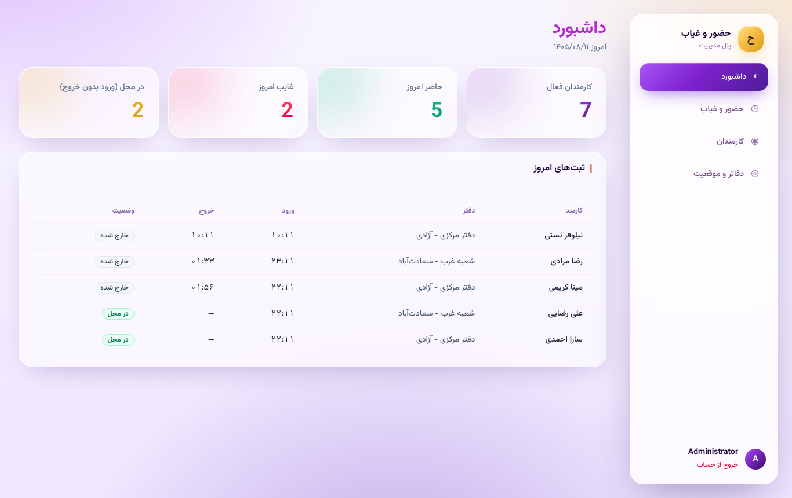
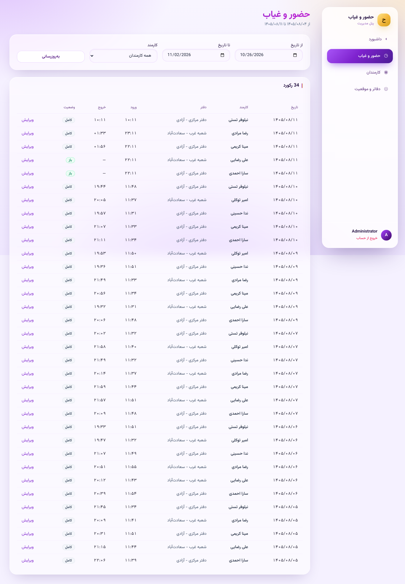
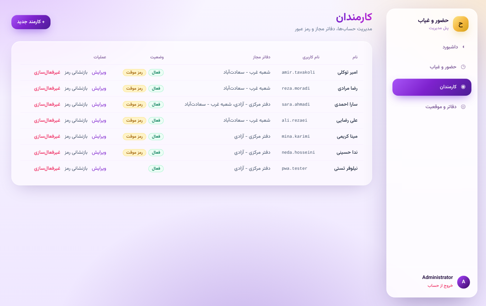
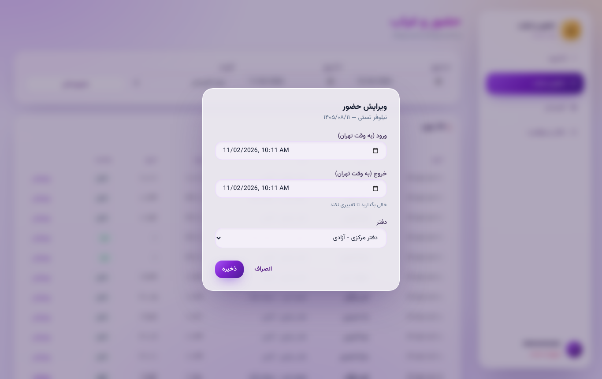
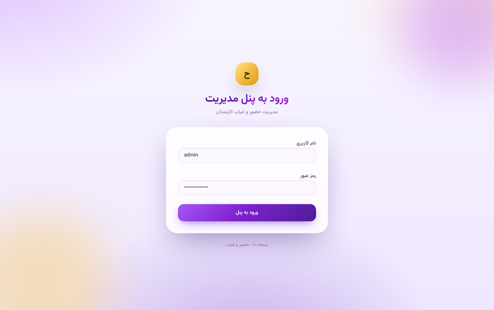
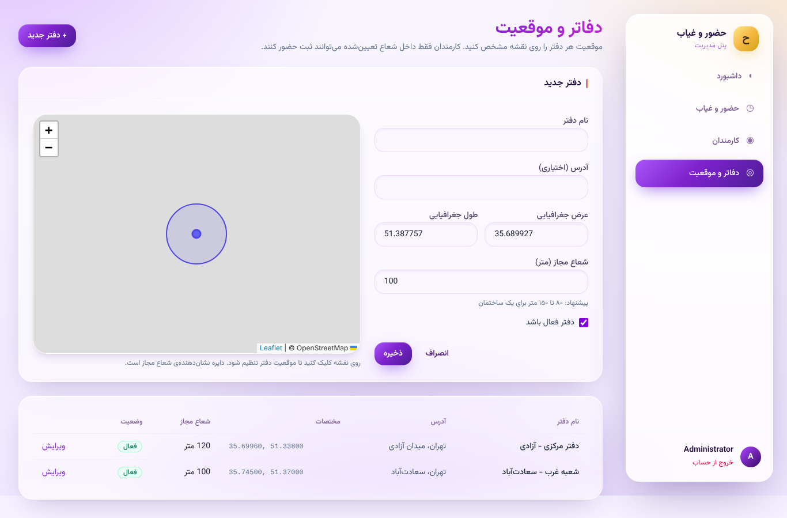

<p align="center">
  
</p>

<h1 align="center">حضوریار</h1>
<p align="center">همراه هوشمند حضور و غیاب کارمندان</p>

<p align="center">
  
  
  
  
</p>

---

سامانه حضور و غیاب **«حضوریار»** شامل چهار بخش است:

| بخش | پوشه | فناوری | کاربر |
|---|---|---|---|
| بک‌اند (API) | `backend/` | FastAPI + SQLite/PostgreSQL | همه |
| پنل مدیریت (وب) | `admin/` | React + Vite + Tailwind | مدیر مجموعه |
| اپ کارمند و مدیر (PWA) | `pwa/` | React + Vite + PWA | کارمندان و مدیر (نصب روی اندروید/iOS) |
| اپ اندروید بومی | `android/` | Kotlin + Jetpack Compose | کارمندان و مدیر (اندروید) |

تم رنگی: **بنفش سلطنتی + طلایی** — لوگو در پوشه `brand/` ساخته شده است (`brand/make_logo.py` اسکریپت بازتولید آن است).

---

## قابلیت‌ها

### کارمند (اپ اندروید / PWA)
- **ثبت ورود و خروج با GPS** — فقط داخل شعاع شعبه‌ای که مدیر تعریف کرده پذیرفته می‌شود؛ دقت GPS نامناسب رد می‌شود.
- **شرح کار روزانه هنگام خروج** — خروج بدون شرح کار پذیرفته نمی‌شود.
- **فراموشی خروج (حداکثر ۲۴ ساعت)** — اگر کارمند خروجش را ثبت نکرد، تا ۲۴ ساعت بعد می‌تواند با مراجعه حضوری به محل شعبه، ساعت خروج روز قبل و شرح کار را ثبت کند. این درخواست **باید توسط مدیر تایید شود**؛ در غیر این صورت آن روز به صورت **غایب** ثبت می‌شود. (مدیر تا پایان روز بعد فرصت تصمیم دارد؛ درخواستِ تصمیم‌نشده منقضی و روز غایب می‌شود.)
- **درخواست مرخصی** — با دلیل و بازه تاریخ؛ فقط پس از تایید مدیر مرخصی محسوب می‌شود و در روزهای مرخصی تاییدشده ثبت ورود غیرممکن است.
- **هفته کاری** — نمایش روز به روز: حاضر / در حال کار / غایب / مرخصی / در انتظار تایید خروج / غیرکاری، به همراه ساعت ورود و خروج، ساعت کاری، تاخیر و خروج زودتر.
- **تاریخچه سوابق** با ساعت‌های به وقت تهران.
- **نصب روی گوشی** — PWA با دکمه نصب روی اندروید و راهنمای نصب iOS؛ اپ بومی اندروید در پوشه `android/`.
- **بخش مدیریت داخل اپ** — مدیر با اکانت خودش وارد اپ می‌شود و داشبورد، تایید مرخصی‌ها، تایید خروج فراموش‌شده و مشاهده حضور و غیاب را در گوشی می‌بیند.

### مدیر (پنل وب + داخل اپ)
- **داشبورد**: حاضر/غایب/مرخصی امروز، درخواست‌های در انتظار، خروج‌های باز.
- **کارمندان**: ساخت، ویرایش، فعال/غیرفعال، ریست رمز (اکانت‌ها را مدیر می‌سازد).
- **شعب و موقعیت**: تعریف مختصات و شعاع مجاز روی نقشه (مبنای تایید حضور).
- **برنامه کاری**: روزهای کاری هفته، ساعت رسمی شروع/پایان و مهلت تاخیر — از پنل مدیریت.
- **حضور و غیاب**: مشاهده و فیلتر سوابق، اصلاح دستی، **تایید/رد** هر روز (رد یعنی غایب).
- **تایید مرخصی و خروج فراموش‌شده** با یادداشت.
- **گزارش ساعات کاری هر کارمند**: جدول روزانه + جمع کل (حاضر، غایب، مرخصی، مجموع ساعت، تاخیر، خروج زودتر).
- **خروجی اکسل**: برای هر کارمند به تنهایی و برای همه اعضا (شامل خلاصه و سوابق روزانه با تاریخ شمسی).

---

## نمای برنامه

| داشبورد مدیر | حضور و غیاب |
|---|---|
|  |  |

| کارمندان | ویرایش رکورد حضور |
|---|---|
|  |  |

| صفحه ورود | تعریف شعبه روی نقشه |
|---|---|
|  |  |

---

## ساختار پروژه

```
attendance-app/
├── backend/          # FastAPI، مدل‌ها، روترها، مایگریشن و تست‌ها
│   ├── app/
│   ├── scripts/      # seed_demo.py، reset_data.py، smoke_test.py
│   └── tests/
├── admin/            # پنل مدیریت (React + Vite + Tailwind)
├── pwa/              # اپ نصب‌شدنی کارمند و مدیر (React + PWA)
├── android/          # اپ بومی اندروید (Kotlin + Jetpack Compose)
├── brand/            # لوگو و آیکون‌ها
├── screenshots/      # تصاویر مستندات
├── scripts/          # اسکریپت‌های ساخت APK و اجرای سرور
└── docker-compose.yml
```

---

## بخش ۱: پیش‌نیازها

- **Python 3.10+** (برای بک‌اند و تست‌ها)
- **Node.js 20+** (برای ساخت پنل مدیریت و PWA)
- **Docker** (اختیاری، برای اجرای با PostgreSQL)
- **Android Studio** (فقط برای ساخت APK اپ بومی)
- **Google Chrome** (برای تست)

---

## شروع سریع

```bash
git clone https://github.com/CarOfficial/attendance-app.git
cd attendance-app
```

سپس مراحل بخش‌های ۲ تا ۵ را به ترتیب انجام دهید (بک‌اند → پنل مدیریت → PWA → اپ اندروید).

---

## بخش ۲: اجرای بک‌اند

### حالت الف: اجرا با SQLite (بدون Docker) — پیشنهادی برای شروع

```powershell
cd attendance-app/backend
python -m venv .venv
.\.venv\Scripts\activate          # ویندوز؛ در لینوکس: source .venv/bin/activate
pip install -r requirements-dev.txt

$env:DATABASE_URL="sqlite:///./dev.db"
$env:JWT_SECRET="dev-secret-dev-secret-dev-secret-1234"
$env:ADMIN_BOOTSTRAP_PASSWORD="Dev-Admin-Pass-1"

uvicorn app.main:app --reload
```

در لینوکس/macOS به جای `$env:...` از `export ...` استفاده کنید.

- مستندات API: `http://127.0.0.1:8000/docs`
- تست‌ها: `pytest -q`
- داده نمونه (اختیاری): `python scripts/seed_demo.py --admin-password Dev-Admin-Pass-1`

> اگر از نسخه قدیمی‌تر این پروژه دیتابیس دارید، نگران نباشید: ستون‌های جدید به‌صورت خودکار اضافه می‌شوند (`app/migrate.py`). در صورت بروز مشکل، `dev.db` را حذف و دوباره اجرا کنید.

### حالت ب: اجرا با Docker

```bash
cd attendance-app
cp backend/.env.example backend/.env   # مقادیر را تغییر دهید
echo "DB_PASSWORD=همان_رمز_دیتابیس" > .env
docker compose up -d --build
curl http://127.0.0.1:8000/api/v1/health   # باید ok ببینید
```

---

## بخش ۳: پنل مدیریت (admin)

```powershell
cd attendance-app/admin
npm install
npm run dev          # http://localhost:5173
npm run build        # خروجی نهایی در dist/
```

ورود با یوزرنیم `admin` و رمز `ADMIN_BOOTSTRAP_PASSWORD`. (در داده نمونه: `Admin-Demo-456`.)

---

## بخش ۴: اپ PWA (کارمند و مدیر)

```powershell
cd attendance-app/pwa
npm install
npm run dev          # http://localhost:5174
```

- **اندروید**: آدرس سرور را در Chrome باز کنید → منوی ⋮ → **نصب اپ** (یا دکمه داخل برنامه).
- **آیفون**: آدرس باید **HTTPS** باشد → Safari → Share → **Add to Home Screen**.
- تست خودکار: ابتدا بک‌اند و داده نمونه را اجرا کنید، سپس `npm run build && npm run preview` و در نهایت `python e2e/run_e2e.py`.

---

## بخش ۵: اپ اندروید بومی

1. Android Studio → **Open** → پوشه `attendance-app/android`
2. صبر تا Gradle Sync تمام شود.
3. نسخه Debug به `http://10.0.2.2:8000/api/v1/` وصل می‌شود (بک‌اند روی همان کامپیوتر باید اجرا باشد).
4. برای گوشی واقعی: `API_BASE_URL` در `android/app/build.gradle.kts` را به IP کامپیوتر در شبکه تغییر دهید و همان IP را در `res/xml/network_security_config.xml` مجاز کنید.
5. ساخت APK از خط فرمان (نیازمند Android SDK):

```bash
./scripts/build_apk.sh http://192.168.1.13:8000/
# آدرس باید با / تمام شود؛ خروجی در dist/HozoorYar-<version>.apk
```

> در اپ، آدرس سرور به‌صورت منوی کشویی از آدرس‌های ذخیره‌شده انتخاب می‌شود و نیازی به تایپ دوباره ندارد. نشست ورود دائمی است و فقط با تغییر یا بازنشانی رمز باطل می‌شود.

---

## بخش ۶: گردش کار اصلی

1. **ورود به پنل مدیریت** → «برنامه کاری»: روزها و ساعت رسمی را تعریف کنید.
2. **شعبه بسازید** (منوی شعب): نام، آدرس، مختصات و شعاع مجاز روی نقشه.
3. **کارمند بسازید** (منوی کارمندان): یوزرنیم، نام، رمز اولیه و شعبه مجاز.
4. کارمند با رمز اولیه وارد اپ می‌شود، رمز را عوض می‌کند و با GPS ثبت ورود/خروج می‌زند.
5. خروج بدون **شرح کار روزانه** پذیرفته نمی‌شود.
6. فراموشی خروج: کارمند تا ۲۴ ساعت بعد درخواست می‌دهد → مدیر از «خروج فراموش‌شده» تایید/رد می‌کند (رد = غایب).
7. مرخصی: کارمند درخواست می‌دهد → مدیر از «مرخصی‌ها» تایید/رد می‌کند.
8. گزارش هفتگی و ساعات کاری در «گزارش و ساعات کاری»؛ خروجی اکسل همان‌جا قابل دانلود است.

---

## بخش ۷: نکات امنیتی قبل از انتشار

- همه مقادیر `CHANGE_ME` و `JWT_SECRET` را عوض کنید (`python -c "import secrets; print(secrets.token_urlsafe(48))"`).
- پنل مدیریت، PWA و API حتماً پشت **HTTPS** باشند (بدون HTTPS موقعیت مکانی روی iOS کار نمی‌کند).
- فایل‌های `.env` را در `.gitignore` نگه دارید.
- از دیتابیس برنامه‌ریزی پشتیبان‌گیری کنید.

---

## بخش ۸: عیب‌یابی سریع

| مشکل | راه‌حل |
|---|---|
| API بالا نمی‌آید | لاگ‌ها و `DATABASE_URL` را بررسی کنید |
| «خارج از محدوده» برای کارمند داخل محل | شعاع شعبه را بزرگ‌تر کنید یا مختصات را دوباره روی نقشه بگذارید |
| «دقت موقعیت پایین است» | GPS را روشن کنید و به فضای باز بروید |
| خروج دیروز ثبت نشده و امروز نمی‌تواند ورود بزند | از بخش «فراموشی خروج» در اپ اقدام کند (تا ۲۴ ساعت) |
| مرخصی درخواستی نمایش داده نمی‌شود | فقط پس از **تایید مدیر** مرخصی اعمال می‌شود |
| خطا در پنل بعد از به‌روزرسانی | `npm install` را دوباره بزنید |
| Android به سرور وصل نمی‌شود | `API_BASE_URL` و اجرای بک‌اند را بررسی کنید |
